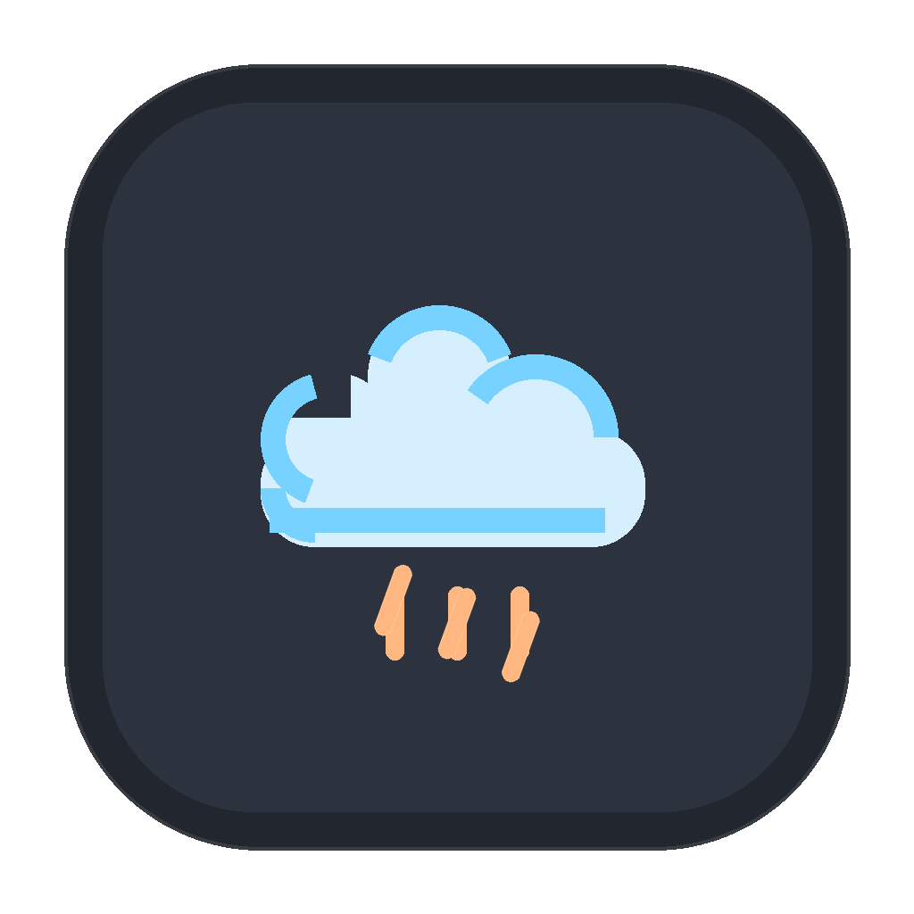
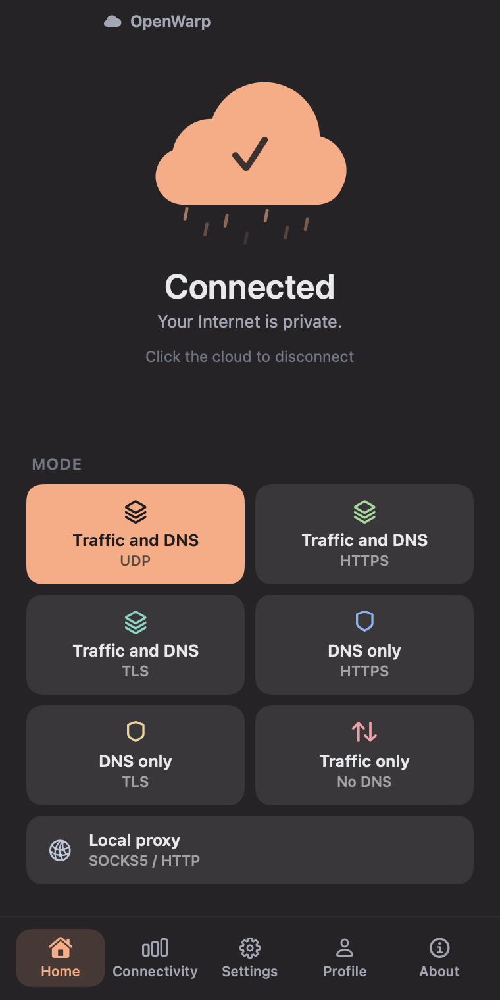
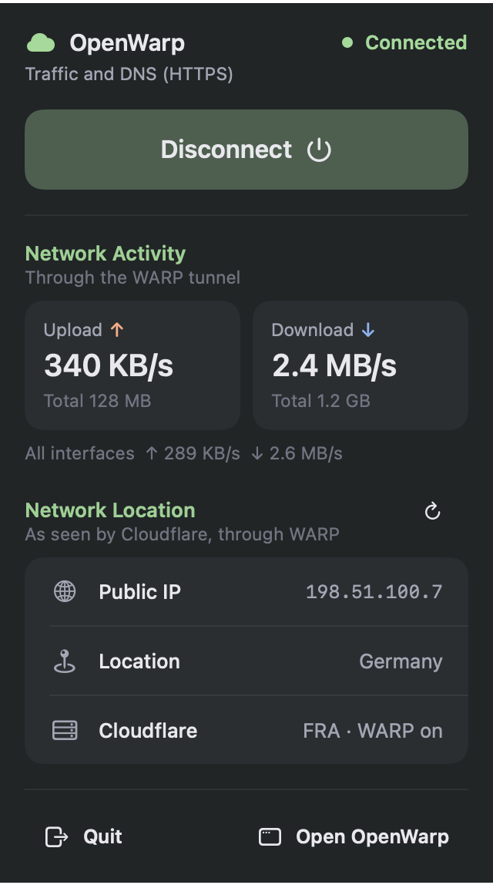
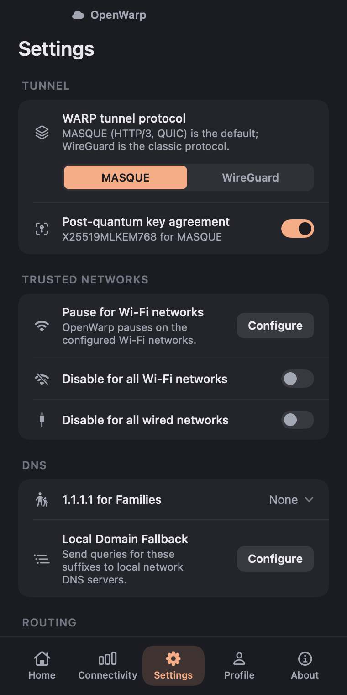

<p align="center"></p>

<h1 align="center">OpenWarp</h1>

<div dir="rtl">

<p align="center">یک کلاینت مستقل و متن‌باز برای macOS که به شبکهٔ Cloudflare WARP وصل می‌شود.</p>

<p align="center"><a href="https://github.com/ImanMontajabi/OpenWarp/releases/latest"><b>دانلود برای macOS</b></a> ·
<a href="#install">نصب</a> · <a href="#limitations">محدودیت‌ها</a> · <a href="README.md">English</a></p>

OpenWarp سه بخش دارد: یک سرویس پس‌زمینه (daemon) که با Go نوشته شده، یک ابزار خط فرمان به نام `openwarp`
(شبیه `warp-cli`)، و یک برنامهٔ بومی macOS با SwiftUI که در نوار منو (menu bar) هم یک داشبورد دارد.

> **OpenWarp هیچ وابستگی‌ای به شرکت Cloudflare ندارد و Cloudflare آن را تأیید یا پشتیبانی نمی‌کند.** «Cloudflare» و
> «WARP» علامت‌های تجاری Cloudflare, Inc. هستند و اینجا فقط برای توضیح سازگاری آمده‌اند. OpenWarp به سرویس عمومی
> WARP کلادفلر وصل می‌شود؛ پس استفاده از آن یعنی پذیرفتن
> [شرایط استفادهٔ Cloudflare WARP](https://www.cloudflare.com/application/terms/).

**وضعیت:** نسخهٔ `0.1.0` اولین نسخهٔ عمومی و آزمایشی (MVP) است. ممکن است ایراد داشته باشد؛
[محدودیت‌های شناخته‌شده](#limitations) را بخوانید.

</div>

<p align="center">
  
  
  
</p>

<div dir="rtl">

## چرا OpenWarp؟

کلاینت رسمی WARP متن‌بسته است. OpenWarp پیاده‌سازی کوچک و خوانایی از همان پروتکل‌هاست که هر کسی می‌تواند
کدش را بررسی کند، خودش بسازد و تغییرش دهد. رفتار آن از بررسی نحوهٔ ارتباط کلاینت رسمی macOS (نسخهٔ
2026.8.2115.0) با شبکه به دست آمده است؛ هیچ کدی از Cloudflare در آن نیست.

## امکانات

| بخش | کاری که OpenWarp انجام می‌دهد |
|---|---|
| حالت‌های اتصال | هر هفت حالت کلاینت رسمی: `warp` (ترافیک و DNS روی UDP)، `warp+doh`، `warp+dot`، `doh`، `dot`، `proxy` (پروکسی محلی SOCKS5/HTTP بدون نیاز به دسترسی مدیر) و `tunnel_only` |
| پروتکل تونل | MASQUE (HTTP/3 روی QUIC، با تبادل کلید پساکوانتومی اختیاری) و WireGuard |
| ثبت دستگاه | ثبت این مک، نمایش یا حذف ثبت، افزودن کلید لایسنس WARP+، فهرست دستگاه‌های حساب |
| تنظیمات | تونل جداگانه (Split tunnel)، دامنه‌های محلی، ‏1.1.1.1 for Families، شبکه‌های Wi-Fi/Ethernet مورد اعتماد، MTU، پورت پروکسی، تغییر endpoint، چرخش کلید |
| پایداری | اتصال دوباره به‌صورت خودکار، امتحان endpoint و پورت‌های دیگر، اتصال دوباره هنگام تغییر شبکه؛ بازگرداندن مسیرها و DNS بعد از کرش |
| جلوگیری از نشت | کیل‌سوییچ (آزمایشی، با pf مک، به‌صورت پیش‌فرض خاموش)، مسدود کردن IPv6 وقتی تونل IPv6 ندارد، مسدود کردن DNS شبکهٔ محلی، و بررسی اتصال (مسیرها، DNS، کیل‌سوییچ و در صورت تمایل `warp=on` از خود Cloudflare). [حریم خصوصی و جلوگیری از نشت](docs/privacy-and-leak-protection.md) (انگلیسی) |
| برنامه | پنجرهٔ جمع‌وجور با صفحه‌های Home، Connectivity، Settings، Profile و About و دکمهٔ ابری برای اتصال؛ راه‌اندازی سرویس پس‌زمینه در اولین اجرا |
| نوار منو | وضعیت، دکمهٔ اتصال، سرعت آپلود و دانلود، و IP عمومی، کشور و دیتاسنتر Cloudflare |

پیاده‌سازی نشده: Zero Trust / Teams، MDM، DEX، بررسی وضعیت دستگاه، HTTP/2 برای MASQUE و تونل جداگانه بر اساس
نام دامنه.

## پیش‌نیازها

- macOS 14 (Sonoma) یا جدیدتر.
- Apple silicon یا Intel: برنامه universal است. تا حالا فقط روی Apple silicon آزمایش شده؛ نسخهٔ Intel ساخته و در
  CI بررسی می‌شود ولی روی سخت‌افزار Intel آزمایش نشده است.
- دسترسی مدیر (administrator) برای نصب سرویس پس‌زمینه، که حالت‌های VPN کامل دستگاه (`warp`، `warp+doh`،
  `warp+dot`، `doh`، `dot`، `tunnel_only`) به آن نیاز دارند. حالت `proxy` بدون آن کار می‌کند.
- برای ساختن از سورس: Go 1.27 و Xcode 27 (یا ابزارهای خط فرمان آن).

<a id="install"></a>

## نصب

1. فایل `OpenWarp-v<version>-macos-universal.dmg` و `SHA256SUMS.txt` را از
   [آخرین نسخه](https://github.com/ImanMontajabi/OpenWarp/releases/latest) دانلود کنید و درستی دانلود را بررسی کنید:

</div>

```sh
shasum -a 256 -c SHA256SUMS.txt
```

<div dir="rtl">

2. فایل DMG را باز کنید و **OpenWarp** را به **Applications** بکشید.
3. OpenWarp را از Applications باز کنید.
4. OpenWarp **امضای Developer ID اپل ندارد و notarize نشده است** (این پروژه عضویت Apple Developer Program
   ندارد)، پس ممکن است macOS بگوید نمی‌تواند برنامه را بررسی کند. به **System Settings ← Privacy & Security**
   بروید، پیام مربوط به OpenWarp را در بخش Security پیدا کنید، روی **Open Anyway** بزنید و تأیید کنید. این کار
   فقط یک بار لازم است. متن و مراحل در نسخه‌های مختلف macOS فرق دارد و مک‌هایی که سازمانی مدیریت می‌شوند ممکن
   است اصلاً اجازه ندهند. **برای اجرای OpenWarp هرگز Gatekeeper را خاموش نکنید.**
5. در اولین اجرا، OpenWarp سرویس پس‌زمینه‌اش را توضیح می‌دهد و دکمهٔ **Install Background Service** را نشان
   می‌دهد. macOS رمز مدیر را در پنجرهٔ خودش می‌پرسد (OpenWarp هرگز آن را نمی‌بیند). سرویس در
   `/Library/PrivilegedHelperTools` کپی می‌شود تا بعد از بیرون آوردن DMG هم کار کند، و برنامه قبل از ادامه
   بررسی می‌کند که سرویس در حال اجراست.

برای حذف، این دستور را بزنید و بعد برنامه را به سطل زباله ببرید. ثبت دستگاه و تنظیمات در
`/Library/Application Support/openwarp` می‌ماند.

</div>

```sh
sudo /Applications/OpenWarp.app/Contents/Resources/openwarp service uninstall
```

<div dir="rtl">

## استفاده

در صفحهٔ Home با کلیک روی ابر وصل یا قطع می‌شوید و یکی از هفت حالت را انتخاب می‌کنید؛ بقیهٔ کارها در Settings،
Profile (ثبت دستگاه، لایسنس WARP+، دستگاه‌ها) و داشبورد نوار منو است. همه‌چیز از Terminal هم در دسترس است:

</div>

```sh
openwarp registration new --accept-tos
openwarp mode warp            # یا warp+doh، warp+dot، doh، dot، proxy، tunnel_only
openwarp connect
openwarp status
openwarp service status       # آیا سرویس پس‌زمینه نصب، در حال اجرا و به‌روز است؟
openwarp killswitch on        # مسدود کردن ترافیک بیرون از تونل (آزمایشی)
openwarp verify --cloudflare  # بررسی مسیرها، DNS و کیل‌سوییچ، و پرسیدن از Cloudflare
```

<div dir="rtl">

OpenWarp نمی‌گذارد شبکهٔ محلی و سرویس‌دهندهٔ اینترنت شما ببینند به چه سایت‌هایی می‌روید، و آن سایت‌ها به‌جای
آدرس شما یک آدرس Cloudflare می‌بینند. **این یک ابزار ناشناس‌ماندن نیست:** Cloudflare آدرس IP شما و مقصد ترافیکتان
را می‌بیند، و OpenWarp تضمین نمی‌کند که هیچ چیزی نشت نکند یا هویت شما قابل شناسایی نباشد. سند
[حریم خصوصی و جلوگیری از نشت](docs/privacy-and-leak-protection.md) (انگلیسی) توضیح می‌دهد چه چیزی محافظت می‌شود و
چه چیزی نه.

دستورهای بیشتر: `openwarp help`.

ثبت دستگاه (از جمله کلیدهای خصوصی و توکن) در فایل `state.json` با دسترسی `0600` در
`/Library/Application Support/openwarp` نگه داشته می‌شود. **این فایل را با هیچ کس به اشتراک نگذارید.**

## ساختن از سورس

</div>

```sh
git clone https://github.com/ImanMontajabi/OpenWarp.git
cd OpenWarp
./build.sh        # تست‌های Go را اجرا می‌کند و build/openwarp و build/OpenWarp.app را می‌سازد
```

<div dir="rtl">

بدون دسترسی مدیر، حالت `proxy` یک پروکسی محلی SOCKS5/HTTP روی `127.0.0.1:40000` باز می‌کند:

</div>

```sh
./build/openwarp daemon &
./build/openwarp registration new --accept-tos
./build/openwarp mode proxy && ./build/openwarp connect
curl -x socks5h://127.0.0.1:40000 https://www.cloudflare.com/cdn-cgi/trace   # دنبال warp=on بگردید
```

<div dir="rtl">

جزئیات معماری، توسعه و مشارکت در [README انگلیسی](README.md) و [CONTRIBUTING.md](CONTRIBUTING.md) آمده است.

<a id="limitations"></a>

## محدودیت‌های شناخته‌شده

- اولین نسخهٔ MVP: در حالت `proxy` (ثبت دستگاه، MASQUE و WireGuard) به‌صورت زنده بررسی شده و نویسنده آن را در حالت
  `warp` روی یک مک Apple silicon استفاده کرده است. حالت‌های دیگر، مک‌های Intel و macOS قدیمی‌تر از 26 آزمایش نشده‌اند.
- حالت‌های کامل دستگاه، مسیرها و DNS را با `route` و `networksetup` تغییر می‌دهند، نه با Network Extension اپل. اگر
  سرویس هنگام اتصال از کار بیفتد، بعد از اجرای دوباره مسیرها و DNS را برمی‌گرداند؛ دستور `sudo openwarp recover` هم
  همین کار را دستی انجام می‌دهد.
- کیل‌سوییچ آزمایشی است. اگر اتصال شما را قطع کرد، قطع اتصال (disconnect) کنید یا `sudo openwarp recover` را بزنید.
  وقتی کیل‌سوییچ روشن است، قانون‌های فایروال‌های pf دیگر (مثلاً برنامه‌هایی که برای هر اپ قانون مسدودسازی دارند) روی
  ترافیکی که از تونل یا شبکهٔ محلی می‌گذرد اعمال نمی‌شوند.
- هر کاربر این مک می‌تواند وضعیت سرویس را ببیند؛ فقط root، مدیرها و کاربری که سرویس را نصب کرده می‌توانند آن را
  کنترل کنند.
- برنامه روزی یک بار از GitHub (`api.github.com`) نسخهٔ جدید را می‌پرسد؛ در Settings ← Updates خاموش می‌شود. نسخهٔ
  جدید هرگز خودکار نصب نمی‌شود.
- نمایش IP عمومی در نوار منو از `www.cloudflare.com/cdn-cgi/trace` می‌پرسد؛ در Settings ← Privacy خاموش می‌شود.
- نصب‌کنندهٔ سرویس داخل برنامه به همان بستهٔ برنامه‌ای که از آن اجرا می‌شود اعتماد می‌کند؛ پس فقط از صفحهٔ
  [Releases](https://github.com/ImanMontajabi/OpenWarp/releases) همین مخزن یا از نسخه‌ای که خودتان ساخته‌اید نصب کنید.
- OpenWarp به API مستندنشدهٔ کلاینت Cloudflare وابسته است. Cloudflare هر وقت بخواهد می‌تواند آن را تغییر دهد، و اینکه
  WARP روی یک شبکهٔ مشخص کار کند یا نه به همان شبکه بستگی دارد.

## امنیت

آسیب‌پذیری‌ها را به‌صورت خصوصی و طبق [SECURITY.md](SECURITY.md) گزارش کنید، نه در issueهای عمومی.

## مجوز

[MIT](LICENSE). ماژول‌های Go شخص ثالث مجوزهای خودشان را دارند؛ متن آن‌ها در
[THIRD_PARTY_NOTICES.md](THIRD_PARTY_NOTICES.md) است.

</div>
