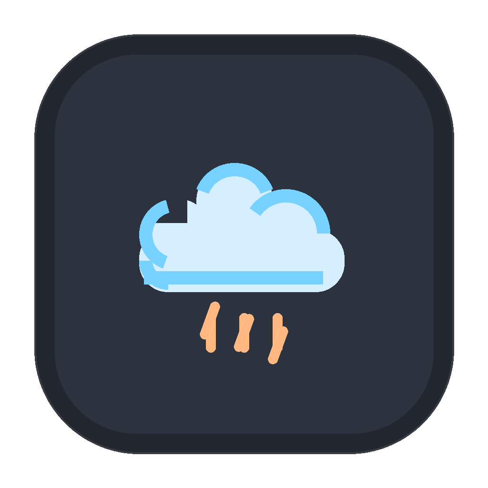
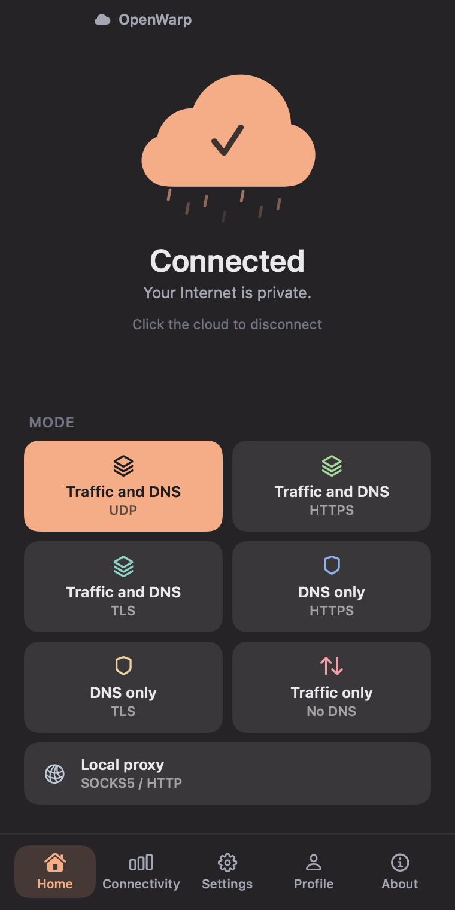
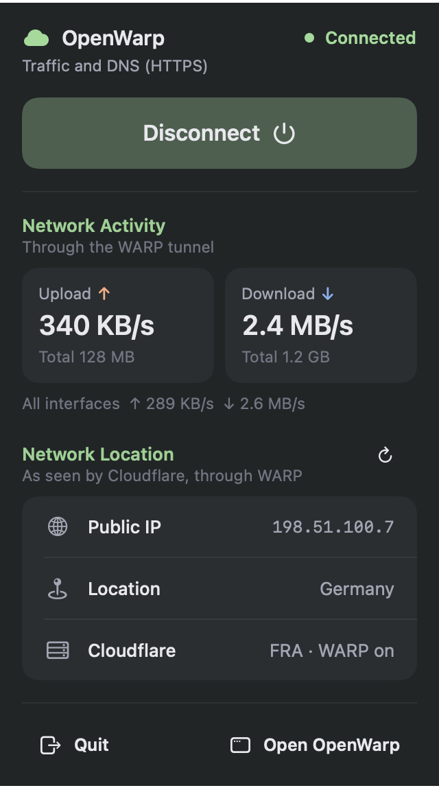
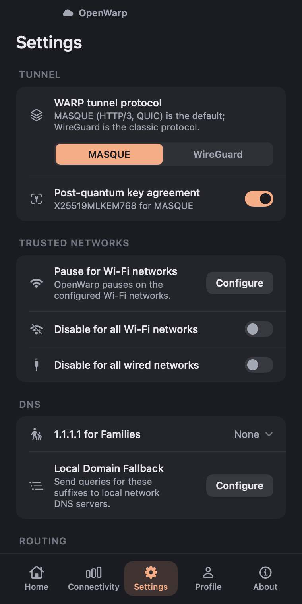

<p align="center"></p>

<h1 align="center">OpenWarp</h1>

<p align="center">An independent, open-source macOS client for the Cloudflare WARP network.</p>

<p align="center"><a href="https://github.com/ImanMontajabi/OpenWarp/releases/latest"><b>Download for macOS</b></a> ·
<a href="#install">Install</a> · <a href="#known-limitations">Limitations</a> · <a href="CHANGELOG.md">Changelog</a></p>

OpenWarp has three parts: a background daemon written in Go, a `warp-cli`-style command-line tool
(`openwarp`), and a native SwiftUI app with a menu bar dashboard.

> **OpenWarp is not affiliated with, endorsed by or supported by Cloudflare, Inc.** "Cloudflare" and "WARP" are
> trademarks of Cloudflare, Inc. and are used here only to describe compatibility. OpenWarp talks to Cloudflare's
> public WARP service, so using it means accepting the
> [Cloudflare WARP Terms of Service](https://www.cloudflare.com/application/terms/).

**Status:** `0.1.0` is the first public MVP release. Expect rough edges; see
[Known limitations](#known-limitations).

<p align="center">
  
  
  
</p>
<p align="center"><sub>Rendered from the app's own views by its snapshot tests, with sample data (documentation
IP addresses, no real account).</sub></p>

## Why

The official WARP client is closed source. OpenWarp is a small, readable implementation of the same client
protocols that anyone can audit, build and change. Its behaviour was worked out by studying how the official
macOS client (version 2026.8.2115.0) talks to the network; no Cloudflare code is included.

## Features

| Area | What OpenWarp does |
|---|---|
| Connection modes | All seven modes of the official client: `warp` (traffic and DNS over UDP), `warp+doh`, `warp+dot`, `doh`, `dot`, `proxy` (local SOCKS5/HTTP proxy, no root) and `tunnel_only` |
| Tunnel protocols | MASQUE (HTTP/3 CONNECT-IP over QUIC, with optional post-quantum key exchange) and WireGuard |
| Registration | Register this Mac, show or delete the registration, attach a WARP+ license key, list the account's devices |
| Settings | Split tunnel (exclude or include list), local domain fallback, 1.1.1.1 for Families, trusted Wi-Fi/Ethernet, MTU, proxy port, endpoint override, key rotation |
| Reliability | Reconnect with backoff, endpoint and port fallback, restart on network change |
| App | Compact window with Home, Connectivity, Settings, Profile and About pages and a cloud-shaped connect button; first-run setup of the background service |
| Menu bar | Dashboard with status, connect button, live upload/download rates and session totals, and the public IP, country and Cloudflare data centre |

Not implemented: Zero Trust / Teams, MDM, DEX, device posture, the HTTP/2 fallback for MASQUE and
hostname-based split tunnelling.

## Requirements

- macOS 14 (Sonoma) or later.
- Apple silicon or Intel: the app and the bundled CLI are universal (arm64 and x86_64). So far OpenWarp has been
  tested on Apple silicon only; the Intel code is built and checked in CI but not tested on Intel hardware.
- Administrator rights to install the background service, which the full-device VPN modes (`warp`, `warp+doh`,
  `warp+dot`, `doh`, `dot`, `tunnel_only`) need. `proxy` mode runs without it.
- To build from source: Go 1.27 and Xcode 27 (or its command-line tools).

## Install

1. Download `OpenWarp-v<version>-macos-universal.dmg` and `SHA256SUMS.txt` from the
   [latest release](https://github.com/ImanMontajabi/OpenWarp/releases/latest), and check the download:
   `shasum -a 256 -c SHA256SUMS.txt`.
2. Open the DMG and drag **OpenWarp** into **Applications**.
3. Open OpenWarp from Applications.
4. OpenWarp is **not signed with an Apple Developer ID and not notarized** (the project has no Apple Developer
   Program membership), so macOS may say it cannot verify the app. Open **System Settings → Privacy &
   Security**, find the message about OpenWarp under Security, click **Open Anyway** and confirm. This is needed
   once. The exact wording and steps vary between macOS versions, and Macs managed by an organisation may not
   allow it at all. Do not turn off Gatekeeper to run OpenWarp.
5. On first launch OpenWarp explains its background service and offers **Install Background Service**. macOS
   asks for an administrator password in its own dialog (OpenWarp never sees it). The service is copied to
   `/Library/PrivilegedHelperTools`, so it keeps working after you eject the DMG, and the app checks that it is
   running before it continues.

To uninstall: `sudo /Applications/OpenWarp.app/Contents/Resources/openwarp service uninstall`, then move the
app to the Bin. Your registration and settings stay in `/Library/Application Support/openwarp`.

## Use

The app's Home page connects and disconnects (click the cloud) and selects one of the seven modes; Settings,
Profile (registration, WARP+ license, devices) and the menu bar dashboard cover the rest. Everything is also
available from Terminal:

```sh
openwarp registration new --accept-tos
openwarp mode warp            # or warp+doh, warp+dot, doh, dot, proxy, tunnel_only
openwarp connect
openwarp status
openwarp service status       # is the background service installed, running and up to date? (no root needed)
```

More commands: `openwarp help`.

The registration (including its private keys and token) is stored in `state.json` with `0600` permissions in
`/Library/Application Support/openwarp` (root daemon) or `~/Library/Application Support/openwarp` (user daemon).
Never share that file.

## Build from source

```sh
git clone https://github.com/ImanMontajabi/OpenWarp.git
cd OpenWarp
./build.sh                                  # runs the Go tests, then builds build/openwarp and build/OpenWarp.app
scripts/make-dmg.sh build/OpenWarp.app dist/OpenWarp.dmg   # optional: the release DMG layout
```

Without root, `proxy` mode exposes a local SOCKS5/HTTP proxy on `127.0.0.1:40000`:

```sh
./build/openwarp daemon &                  # user daemon; state in ~/Library/Application Support/openwarp
./build/openwarp registration new --accept-tos
./build/openwarp mode proxy && ./build/openwarp connect
curl -x socks5h://127.0.0.1:40000 https://www.cloudflare.com/cdn-cgi/trace   # look for warp=on
```

## How it works

```
OpenWarp.app (SwiftUI) ──runs──> openwarp -j <command> ──HTTP over a unix socket──> openwarp daemon
                                                                                      ├─ WARP device API (registration, keys, license)
                                                                                      └─ tunnel: MASQUE or WireGuard ─> Cloudflare edge
```

The app never talks to the network itself: it runs the CLI with JSON output, and the CLI talks to the daemon
over `/var/run/openwarp.sock` (or a per-user socket). The daemon owns the registration, the tunnel, routes and
DNS. [CLAUDE.md](CLAUDE.md) documents the architecture and protocol details in depth.

```
cmd/openwarp/       CLI and daemon entry point, LaunchDaemon installer
internal/api        WARP device API client
internal/daemon     connection state machine, sessions, unix-socket control API
internal/tunnel     MASQUE (quic-go HTTP/3) and WireGuard (wireguard-go) transports
internal/sysnet     macOS utun, route and DNS integration
internal/dnsproxy   DoH/DoT stub resolver with local domain fallback
internal/proxy      SOCKS5 and HTTP proxy over the userspace network stack
internal/state      persisted registration and settings
internal/keys       Curve25519 and P-256 key generation
ui/macos            SwiftUI app
```

## Development

```sh
go test ./... -race -count=1     # Go unit and integration tests (offline: mock API and mock edge)
go vet ./... && gofmt -l .       # must be clean
scripts/test-app.sh              # SwiftUI unit, contract and snapshot tests (needs Xcode and XcodeGen)
scripts/test-app.sh ui           # plus the XCUITest UI tests
./build.sh                       # full build
```

Tests never touch real Cloudflare registrations, the network configuration or root-only paths. See
[CONTRIBUTING.md](CONTRIBUTING.md) for the full workflow, including the macOS app tests.

## Contributing

Contributions are welcome. Every change goes through a pull request with tests and passing CI; `main` is
protected. Read [CONTRIBUTING.md](CONTRIBUTING.md) first, and report security problems privately as described
in [SECURITY.md](SECURITY.md).

## Known limitations

- First MVP release: verified live in `proxy` mode (registration, MASQUE and WireGuard) and by the author in
  `warp` mode on one Apple silicon Mac. Other root modes, Intel Macs and macOS versions before 26 are untested.
- Full-device modes change routes and DNS with `route` and `networksetup` instead of Apple's Network Extension
  framework. If the daemon is killed while connected, the DNS settings may need to be restored by hand.
- Trusted-network detection by SSID needs Location permission, which OpenWarp does not request yet; the
  Wi-Fi and Ethernet switches work without it.
- Automatic update checks ask GitHub's API (`api.github.com`) for the latest release once a day while the app
  runs. Turn them off in Settings → Updates. New versions are installed by hand from the release page.
- The menu bar's public IP lookup sends a request to `www.cloudflare.com/cdn-cgi/trace` (at most every five
  minutes, and when the connection changes). Turn it off in Settings → Privacy. Cloudflare reports a country and
  data centre, not a city.
- The in-app service installer uses an AppleScript administrator prompt, not `SMAppService`, because that needs a
  Developer ID–signed app. It trusts the app bundle it runs from, so install only from a copy you built or trust.
- Releases are ad-hoc signed, not signed with a Developer ID or notarized, so Gatekeeper warns on first launch
  (see [Install](#install)).
- OpenWarp depends on Cloudflare's undocumented client API. Cloudflare can change it at any time, and whether
  WARP works on a given network depends on that network.

## Security

Report vulnerabilities privately as described in [SECURITY.md](SECURITY.md), not in public issues.

## License

[MIT](LICENSE). Third-party Go modules keep their own licenses (MIT, BSD-3-Clause and Apache-2.0); their texts
are in [THIRD_PARTY_NOTICES.md](THIRD_PARTY_NOTICES.md), which also ships inside the app.
